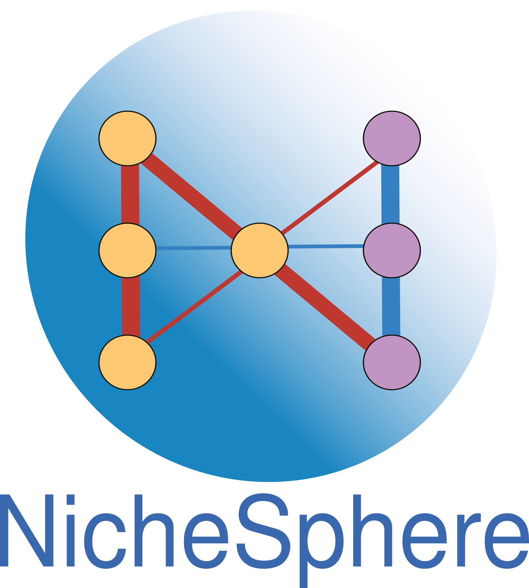

# NicheSphere

[![Tests][badge-tests]][tests]
[![Documentation][badge-docs]][documentation]
[![PyPI version][badge-pypi]][pypi]
[![DOI][badge-doi]][doi]

[badge-tests]: https://img.shields.io/github/actions/workflow/status/CostaLab/NicheSphere/test.yaml?branch=dev
[badge-docs]: https://app.readthedocs.org/projects/nichesphere/badge/
[badge-pypi]: https://img.shields.io/pypi/v/NicheSphere.svg
[badge-doi]: https://zenodo.org/badge/685916590.svg

NicheSphere is an scverse-compatible Python library which allows the user to find differential co-localization domains / niches based on cell type pair co-localization probabilities in different conditions. Cell type pair co-localization probabilities can be obtained in different ways, for example, through deconvolution of spatial transcriptomics / PIC-seq data (getting the probabilities of finding each cell type in each spot / multiplet), or counting nearest neighbors of each type for each cell in single cell spatial data like MERFISH or CODEX.

It also offers the possibility to look at biological process based differential communication between cell type pairs or differential co-localization domains based on Ligand-Receptor pairs expression data, which can be obtained from diverse cell-cell communication tools, such as [CrossTalkeR](https://costalab.github.io/CrossTalkeR/).

## Getting started

Please refer to the [documentation][], in particular, the [API documentation][].
The documentation also includes an application example on the Myocardial Infarction atlas data from Kuppe et al. 2022.
The data you'll need to run the tutorials is stored in [Zenodo](https://doi.org/10.5281/zenodo.22678370).

## Installation

You need to have Python 3.12 or newer installed on your system.
If you don't have Python installed, we recommend installing [uv][].

We recommend managing dependencies in project-specific virtual environments to avoid dependency conflicts.
This is most convenient using package managers such as [uv][].
Choose from the options below to install NicheSphere:

1. Add the latest release of `NicheSphere` from [PyPI][] to your `uv` project:

   ```bash
   uv add NicheSphere
   ```

1. Install the latest release into a [standard virtual environment][venv]:

   ```bash
   (after activating your venv)
   pip install NicheSphere
   ```

1. Install the latest development version:

   ```bash
   pip install git+https://github.com/CostaLab/NicheSphere.git  # (or `uv add`)
   ```

To also install the optional network visualization dependencies (`gravis`), add the `viz` extra, e.g. `pip install "NicheSphere[viz]"`.

## Release notes

See the [changelog][].

## Contact

For questions and help requests, you can reach out in the [scverse discourse][].
If you found a bug, please use the [issue tracker][].

## Citation

If you use NicheSphere in your work, please cite it via its [Zenodo record][doi] (see also `CITATION.cff`).

[uv]: https://github.com/astral-sh/uv
[scverse discourse]: https://discourse.scverse.org/
[issue tracker]: https://github.com/CostaLab/NicheSphere/issues
[tests]: https://github.com/CostaLab/NicheSphere/actions/workflows/test.yaml
[documentation]: https://nichesphere.readthedocs.io
[changelog]: https://nichesphere.readthedocs.io/page/changelog.html
[api documentation]: https://nichesphere.readthedocs.io/page/api.html
[pypi]: https://pypi.org/project/NicheSphere/
[doi]: https://doi.org/10.5281/zenodo.18756710
[venv]: https://docs.python.org/3/tutorial/venv.html
